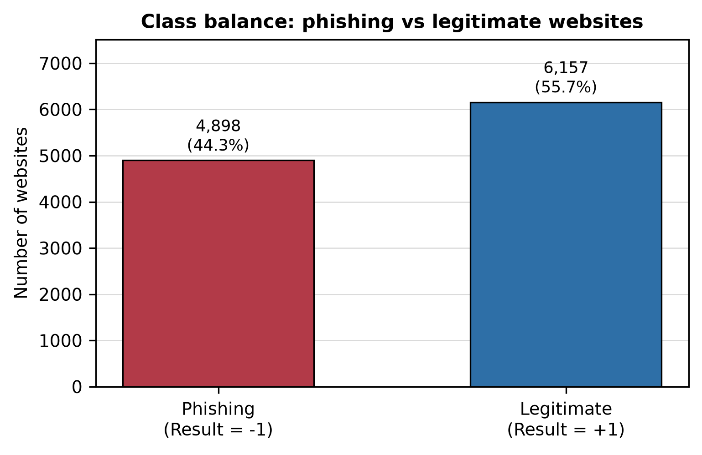
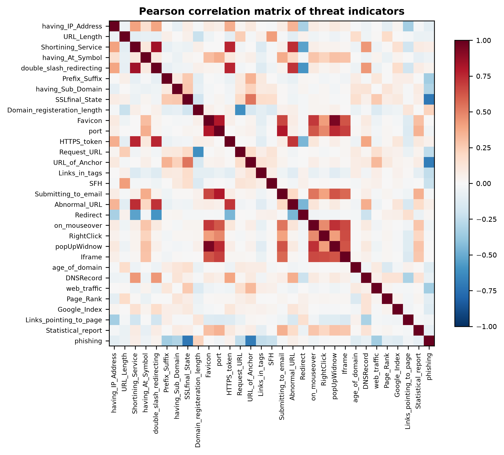
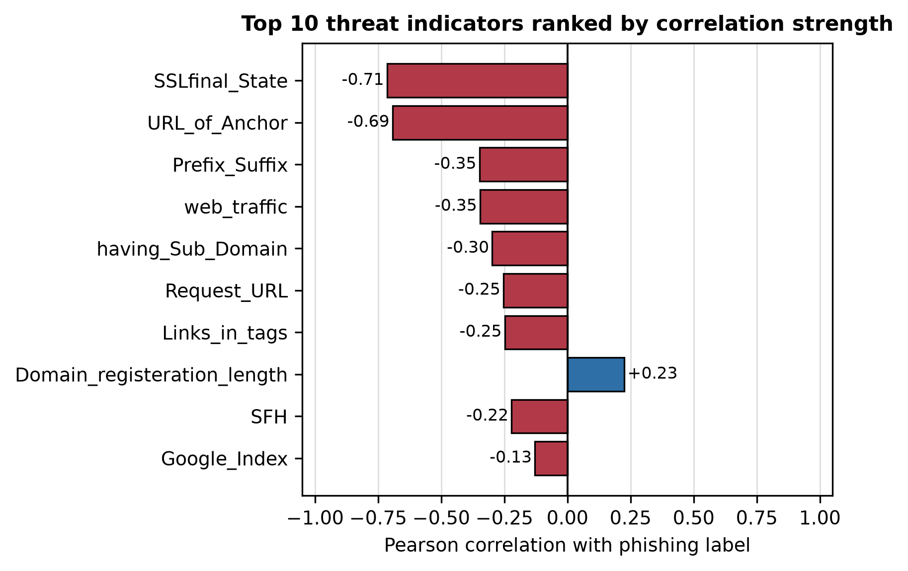
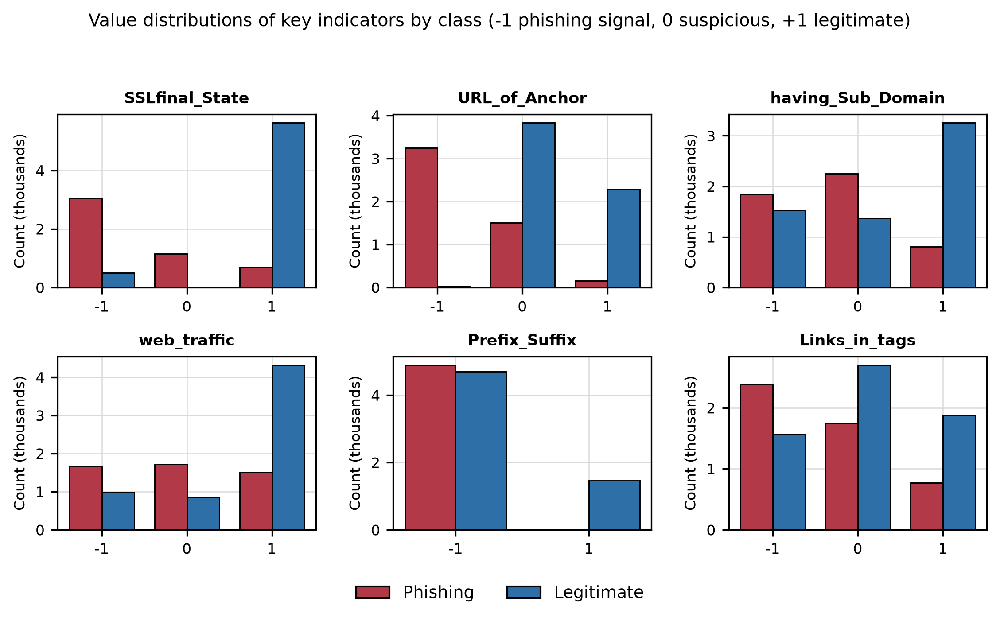
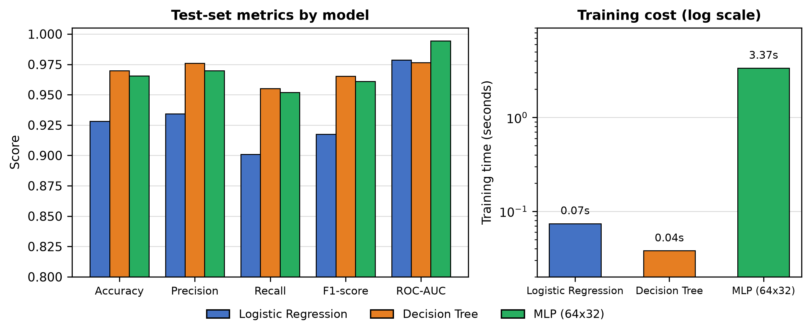
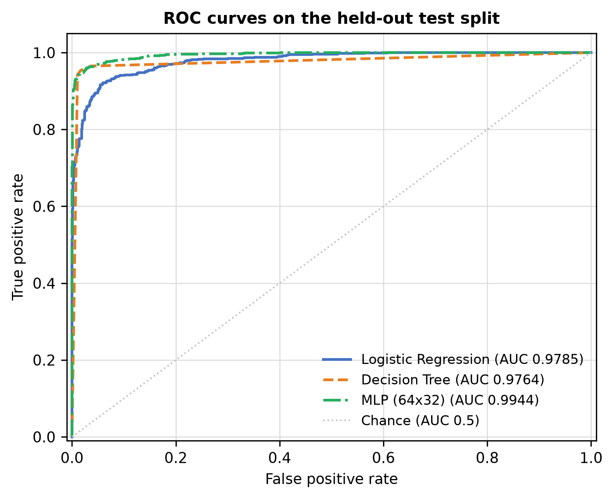
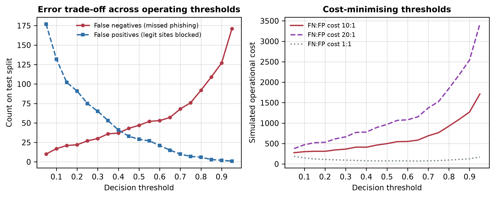

# AI-Driven Phishing Threat Detection Prototype

**Unit 1 Mini Project - Introduction to AI and Cyber Security (ENSP355)**  
**K.R. Mangalam University** | Submitted by **Abhinav Kumar** (Roll No. 2301730191, B.Tech CSE (AIML) - C) | Submitted to Ms. Monika Khatkar

> Dataset: UCI Machine Learning Repository - *Phishing Websites* (ID 327), Mohammad, Thabtah and McCluskey (2012), CC BY 4.0. All report text is black; figures and tables use a professional colour palette.

---

## Contents
- 1. Executive Summary
- 2. Introduction and Objectives
- 3. Dataset and Threat Landscape
- 4. Exploratory Data Analysis
- 5. Methodology
- 6. Results and Benchmarking
- 7. Operational Threshold Analysis
- 8. Ethical Reflection and Responsible AI
- 9. Limitations and Future Work
- 10. Conclusion
- References
- Appendix A. Feature Dictionary
- Appendix B. Reproducibility

## 1. Executive Summary

This mini project develops an end-to-end, reproducible prototype that detects phishing websites from 30 structural and behavioural threat indicators, using the UCI *Phishing Websites* dataset (11,055 websites). EDA shows a moderately balanced problem (44.3% phishing), no missing values, two dominant threat signals (SSL certificate state and anchor-URL behaviour, |r| ~ 0.70), and redundancy clusters among HTML-script indicators. Three models are benchmarked on a stratified 20% hold-out (2,211 websites): Logistic Regression (accuracy 92.81%), a tuned Decision Tree (96.97%, best single-threshold classifier) and a 64x32 MLP (96.56%) with the best ranking quality (ROC-AUC 0.9944). A threshold simulation and explicit cost model convert the metrics into a deployment policy; an ethical review covers proxy bias, privacy, explainability and adversarial drift.

## 2. Introduction and Objectives

Phishing is adversarial and fast-regenerating; blocklists defend against known pages, while machine learning generalises to unseen URLs by learning the statistical fingerprint of malicious design choices. The project implements the five Unit 1 laboratory tasks: (1) workspace bootstrap and reproducible configuration; (2) threat-landscape EDA; (3) supervised ML classification (Logistic Regression, tuned Decision Tree); (4) a deep-learning prototype (Dense 64x32 MLP) with multi-metric benchmarking; and (5) an operational threshold simulation plus ethical reflection. All results are produced by `src/main.py`, and the accompanying notebook `src/cybersecurity_threat_detection.ipynb` reproduces the analysis interactively, so every number is traceable to a script run.

## 3. Dataset and Threat Landscape

### 3.1 Dataset provenance

Published by Mohammad, Thabtah and McCluskey (University of Huddersfield) and distributed by the UCI Machine Learning Repository under CC BY 4.0. Each of the 11,055 rows describes one website with 30 categorical indicators extracted from the URL string, the HTML/JavaScript content, and third-party domain intelligence (WHOIS, DNS, traffic ranks, blacklists). Indicator coding: -1 = phishing signal, 0 = suspicious/neutral, +1 = legitimate signal. The label (-1 phishing / +1 legitimate) is remapped to a binary `phishing = 1` target.

| Property | Value |
|---|---|
| Instances | 11,055 |
| Features | 30 categorical indicators |
| Phishing websites | 4,898 (44.3%) |
| Legitimate websites | 6,157 (55.7%) |
| Missing values | 0 |
| Duplicated feature profiles | 5,206 |

**Table 1. Dataset overview.**

### 3.2 Class balance

Phishing pages account for 44.3% of the corpus (4,898 of 11,055); the imbalance ratio is mild (0.80), so accuracy remains meaningful while precision/recall are tracked per class. No synthetic oversampling is required.

**Figure 1. Class balance of the UCI Phishing Websites dataset.**

### 3.3 A note on duplicated feature profiles

5,206 rows (47%) share an identical feature vector with another row. This is expected with 30 coarse categorical indicators - structurally similar websites collapse onto the same profile. Duplicates are retained because they carry genuine class-prevalence information; removing them would distort the deployment prior.

## 4. Exploratory Data Analysis

### 4.1 Correlation structure

The class label correlates strongly with a compact indicator set led by `SSLfinal_State` and `URL_of_Anchor`; `Favicon`/`port` and `on_mouseover`/`RightClick`/`popUpWidnow`/`Iframe` form near-redundant clusters; most domain-intelligence indicators contribute complementary evidence.

**Figure 2. Pearson correlation matrix of the 30 threat indicators and the phishing label.**

### 4.2 Top threat indicators

| Indicator | Group | Pearson r | What it measures |
|---|---|---|---|
| SSLfinal_State | Address-bar based | -0.715 | SSL certificate validity, trust issuer and certificate age |
| URL_of_Anchor | Abnormal request based | -0.693 | anchor tags linking outside the domain or to '#' |
| Prefix_Suffix | Address-bar based | -0.349 | '-' used inside the domain name (prefix/suffix trick) |
| web_traffic | Domain based | -0.346 | Alexa traffic rank very low or unknown |
| having_Sub_Domain | Address-bar based | -0.298 | number of sub-domains and dots in the URL |
| Request_URL | Abnormal request based | -0.253 | page objects (img/css/js) loaded from external domains |
| Links_in_tags | Abnormal request based | -0.248 | meta/script/link tags referencing external domains |
| Domain_registeration_length | Address-bar based | +0.226 | short domain registration/expiry window |
| SFH | Abnormal request based | -0.221 | form handler empty or pointing to a different domain |
| Google_Index | Domain based | -0.129 | page not indexed by Google |

**Table 2. Top ten phishing-correlated threat indicators.**

**Figure 3. Top ten threat indicators ranked by absolute correlation.**

Coding caveat: the distributed copy of `Domain_registeration_length` is inverted relative to its published definition (phishing sites more often carry the value documented as the legitimate-signal +1). The models absorb the flipped coding, but this underlines the need to audit feature provenance before operational reuse.

### 4.3 Indicator distributions by class

Separation is strongest for `SSLfinal_State`, `URL_of_Anchor` and `web_traffic`; `Prefix_Suffix` separates less cleanly because hyphenated domains are also common among legitimate sites.

**Figure 4. Value distributions of six key indicators by class.**

## 5. Methodology

- **Split:** 8,844 train / 2,211 test (80/20, stratified, seed 42); test set touched once.
- **Preprocessing:** native ordinal coding of the categorical indicators; StandardScaler fitted inside Pipelines on training data only (no leakage).
- **Logistic Regression:** regularised linear baseline (max_iter=1000).
- **Decision Tree:** 5-fold grid search over max_depth (4-10 or unrestricted) and min_samples_leaf (1-10), F1-optimised; selected depth = unrestricted, min_samples_leaf = 1 (CV F1 = 0.9503).
- **MLP (deep-learning prototype):** Dense 64x32 ReLU, Adam optimiser, early stopping on 10% of the training fold, per the laboratory brief.
- **Metrics:** accuracy, precision, recall, F1 (phishing), ROC-AUC, MCC, confusion matrix, wall-clock training time and per-sample inference latency; five-fold cross-validation for stability.

## 6. Results and Benchmarking

### 6.1 Cross-validated stability

| Model | Accuracy | F1-score (phishing) |
|---|---|---|
| Logistic Regression | 0.9282 +/- 0.0043 | 0.9180 +/- 0.0049 |
| Decision Tree | 0.9562 +/- 0.0038 | 0.9503 +/- 0.0041 |
| MLP (64x32) | 0.9555 +/- 0.0042 | 0.9495 +/- 0.0046 |

**Table 3. Five-fold cross-validation on the training partition.**

### 6.2 Hold-out test benchmark

| Model | Accuracy | Precision | Recall | F1 | ROC-AUC | MCC |
|---|---|---|---|---|---|---|
| Logistic Regression | 0.9281 | 0.9344 | 0.9010 | 0.9174 | 0.9785 | +0.8542 |
| Decision Tree | 0.9697 | 0.9760 | 0.9551 | 0.9654 | 0.9764 | +0.9386 |
| MLP (64x32) | 0.9656 | 0.9699 | 0.9520 | 0.9609 | 0.9944 | +0.9304 |

**Table 4. Held-out test-set benchmark (n = 2,211; positive class = phishing).**

The tuned Decision Tree is the strongest single-threshold classifier; the MLP has the best ranking quality (ROC-AUC), which matters most when the operating threshold must move. On coarse categorical feature spaces a well-tuned shallow model remains competitive with a neural network - an honest and instructive result.

**Figure 5. Test-set metrics and training cost (log scale).**

### 6.3 Ranking quality

The MLP dominates the ROC surface across the operating range, reaching ~0.95 true-positive rate at a false-positive rate near 0.02.

**Figure 6. ROC curves on the held-out test split.**

### 6.4 Error anatomy

| Model | False positives | False negatives |
|---|---|---|
| Logistic Regression | 62 | 97 |
| Decision Tree | 23 | 44 |
| MLP (64x32) | 29 | 47 |

**Figure 7. Confusion matrices** (see `../results/fig05_confusion_matrices.png`).

### 6.5 Computational efficiency

| Model | Train time | Inference (us/sample) |
|---|---|---|
| Logistic Regression | 0.07 s | 1.1 |
| Decision Tree | 0.04 s | 0.7 |
| MLP (64x32) | 3.37 s | 2.7 |

**Table 5. Training cost and per-sample inference latency.** All models train in seconds and classify in microseconds - well inside an inline filtering budget.

## 7. Operational Threshold Analysis

### 7.1 The false-positive / false-negative trade-off

Sweeping the MLP threshold 0.05-0.95: at 0.05 the prototype catches 99.0% of phishing but raises 177 false alarms; at 0.90 it raises only 2 false alarms but misses 127 attacks.

**Figure 8. Error trade-off and cost-minimising thresholds.**

| Threshold | Precision | Recall | Accuracy | False positives | False negatives |
|---|---|---|---|---|---|
| 0.10 | 0.879 | 0.983 | 0.933 | 132 | 17 |
| 0.25 | 0.927 | 0.972 | 0.954 | 75 | 27 |
| 0.40 | 0.958 | 0.962 | 0.965 | 41 | 37 |
| 0.50 | 0.970 | 0.952 | 0.966 | 29 | 47 |
| 0.60 | 0.978 | 0.946 | 0.967 | 21 | 53 |
| 0.65 | 0.984 | 0.942 | 0.967 | 15 | 57 |
| 0.80 | 0.993 | 0.906 | 0.956 | 6 | 92 |
| 0.90 | 0.998 | 0.870 | 0.942 | 2 | 127 |

**Table 6. Representative operating points of the MLP prototype.**

### 7.2 Cost-based operating points

With cost = FN x c_FN + FP x c_FP: balanced costs (1:1) optimise at threshold 0.65 (15 FP, 57 FN); when a compromise costs 10x a false alert the optimum moves to the protective end (threshold 0.05, maximum recall). The threshold is a governance decision set from the organisation's own disruption-versus-compromise costs, not a technical default.

### 7.3 Recommended deployment posture

- **Block tier:** act autonomously only above ~0.80-0.90 (precision > 99%).
- **Review tier:** route 0.40-0.80 predictions to analyst inspection or secondary signals before user-facing action.
- **Feedback loop:** log analyst verdicts and retrain on schedule so threshold and model drift together with the threat landscape.

## 8. Ethical Reflection and Responsible AI

**Proxy bias and fairness.** Indicators such as young domains, low traffic and absent search indexing are proxies for atypical-but-legitimate behaviour; an automatic blocker disadvantages small and new publishers. Mitigations: review rather than block at low confidence, audit error rates across domain categories, fast appeals.

**Privacy and data protection.** The prototype consumes structural metadata, not user content or identities. GDPR/DPDP duties (minimisation, purpose limitation) apply to visit logs: retain URLs only as long as triage needs and do not join them with identities beyond security operations. The categorical model stores no reconstructable personal data.

**Explainability and accountability.** Logistic coefficients and decision paths are natively auditable; the MLP trades transparency for ranking quality, so deployments should pair it with post-hoc explanations (e.g. SHAP) and keep an interpretable shadow model. Every automated block should record model version, threshold, features and approver.

**Drift and adversarial adaptation.** Attackers adapt to published detectors; a static model decays. Defences: weekly precision/recall and score-distribution monitoring, scheduled retraining on fresh verdicts, and treating sharp shifts in feature importance as an attack signal. The 2012-vintage corpus means absolute numbers validate the methodology rather than a production guarantee.

**Human-in-the-loop commitments.** Narrow autonomy: reversible high-confidence actions are automated; irreversible actions require analyst confirmation; overrides are logged and fed back into training.

## 9. Limitations and Future Work

Static categorical features compress away URL text, WHOIS timelines and network traces; the corpus is historic and needs a refreshed, documented collection protocol; threshold simulation used a single hold-out split. Future work: gradient-boosted trees and calibrated ensembles, SHAP explanations, adversarial robustness evaluation, and a REST service with streaming drift monitors.

## 10. Conclusion

A complete AI-for-cyber-security workflow on a public phishing corpus: 11,055 websites, 30 indicators, three model families, an explicit operating-point analysis and an ethics review. The tuned Decision Tree achieves the best single-threshold accuracy (96.97%); the MLP the best ranking quality (ROC-AUC 0.9944); all models train in seconds with microsecond inference. The result is a defensible template for building, evaluating and governing ML-based detection systems.

## References

[1] R. M. Mohammad, F. Thabtah and L. McCluskey, "An assessment of features related to phishing websites using an automated technique," ICITST, London, 2012.

[2] R. M. Mohammad, F. Thabtah and L. McCluskey, *Phishing Websites*, UCI Machine Learning Repository, ID 327, 2012. DOI: 10.24432/C51W0X. CC BY 4.0.

[3] F. Pedregosa et al., "Scikit-learn: Machine learning in Python," JMLR, vol. 12, pp. 2825-2830, 2011.

[4] F. Thabtah, "Phishing detection: A literature survey," American Journal of Information Science and Technology, vol. 3, no. 6, 2015.

[5] Regulation (EU) 2016/679 (General Data Protection Regulation), 2016.

[6] Government of India, Digital Personal Data Protection Act, 2023.

[7] D. W. Hosmer and S. Lemeshow, *Applied Logistic Regression*, 3rd ed., Wiley, 2013.

[8] I. Goodfellow, Y. Bengio and A. Courville, *Deep Learning*, MIT Press, 2016.

## Appendix A. Feature Dictionary

Coding: -1 = phishing signal, 0 = suspicious/neutral, +1 = legitimate signal. Descriptions follow the dataset authors' documentation [1].

| Indicator | Group | Description |
|---|---|---|
| having_IP_Address | Address-bar | URL host is an IP address instead of a named domain |
| URL_Length | Address-bar | URL abnormally long (over 54 characters) |
| Shortining_Service | Address-bar | URL issued by a shortening service (tinyURL, bit.ly, ...) |
| having_At_Symbol | Address-bar | '@' symbol embedded in the URL |
| double_slash_redirecting | Address-bar | '//' redirection placed right after the protocol |
| Prefix_Suffix | Address-bar | '-' used inside the domain name (prefix/suffix trick) |
| having_Sub_Domain | Address-bar | number of sub-domains and dots in the URL |
| SSLfinal_State | Address-bar | SSL certificate validity, trust issuer and certificate age |
| Domain_registeration_length | Address-bar | domain registration/expiry window (coding inverted in the public copy) |
| Favicon | Address-bar | favicon loaded from outside the domain |
| port | Address-bar | non-standard ports open or unavailable |
| HTTPS_token | Address-bar | 'https' token embedded misleadingly inside the domain |
| Request_URL | Abnormal request | page objects (img/css/js) loaded from external domains |
| URL_of_Anchor | Abnormal request | anchor tags linking outside the domain or to '#' |
| Links_in_tags | Abnormal request | meta/script/link tags referencing external domains |
| SFH | Abnormal request | form handler empty or pointing to another domain |
| Submitting_to_email | Abnormal request | form submitted through mailto() instead of a server |
| Abnormal_URL | Abnormal request | URL does not match the domain's official registration record |
| Redirect | HTML / JavaScript | page applies more than one redirect |
| on_mouseover | HTML / JavaScript | status bar text hijacked on mouse-over |
| RightClick | HTML / JavaScript | right-click functionality disabled |
| popUpWidnow | HTML / JavaScript | pop-up window containing a form |
| Iframe | HTML / JavaScript | hidden iframe used to obtain personal data |
| age_of_domain | Domain | domain younger than six months |
| DNSRecord | Domain | DNS record missing or empty |
| web_traffic | Domain | Alexa traffic rank very low or unknown |
| Page_Rank | Domain | Google PageRank close to zero |
| Google_Index | Domain | page not indexed by Google |
| Links_pointing_to_page | Domain | abnormal number of inbound links |
| Statistical_report | Domain | domain flagged in statistical blacklist sources (PhishTank, ...) |

**Table 7. The 30 threat indicators and their source surface.**

## Appendix B. Reproducibility

Produced with Python 3.14.0, scikit-learn 1.9.1, pandas 3.1.1, NumPy 2.5.4, matplotlib 3.11.2 on Windows-11-10.0.26300-SP0. Run `python src/main.py` (data, figures, metrics); the notebook `src/cybersecurity_threat_detection.ipynb` reproduces the analysis interactively. Random seed 42, stratified 80/20 split; report generated 2026-11-16 23:22:25.
